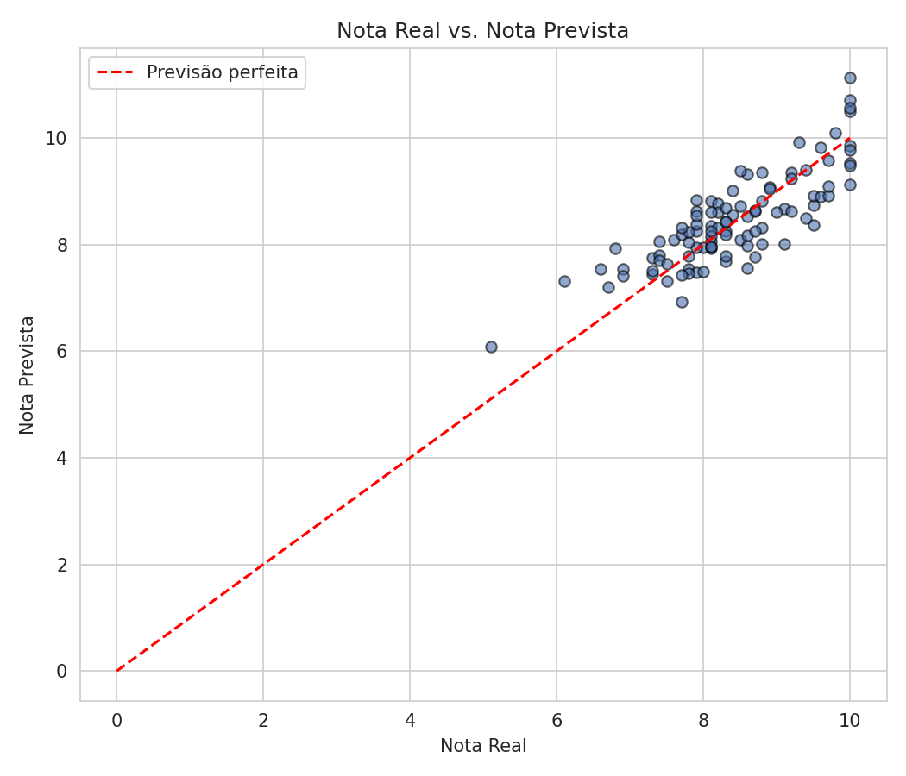
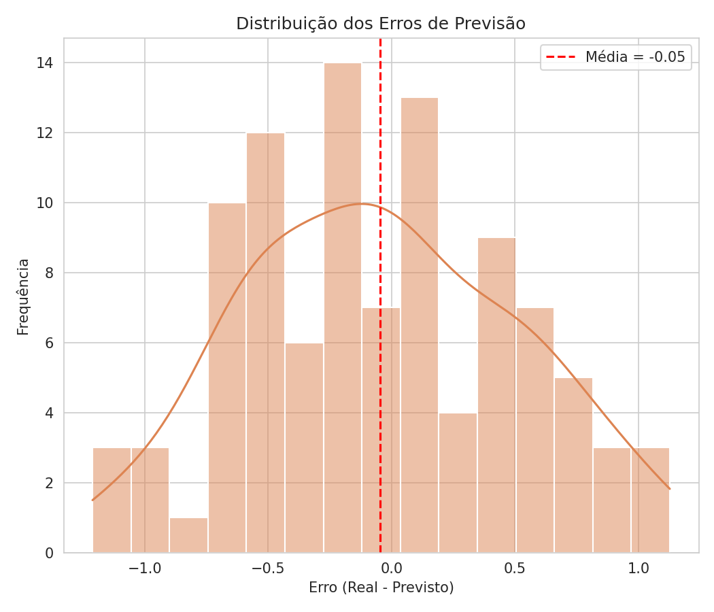
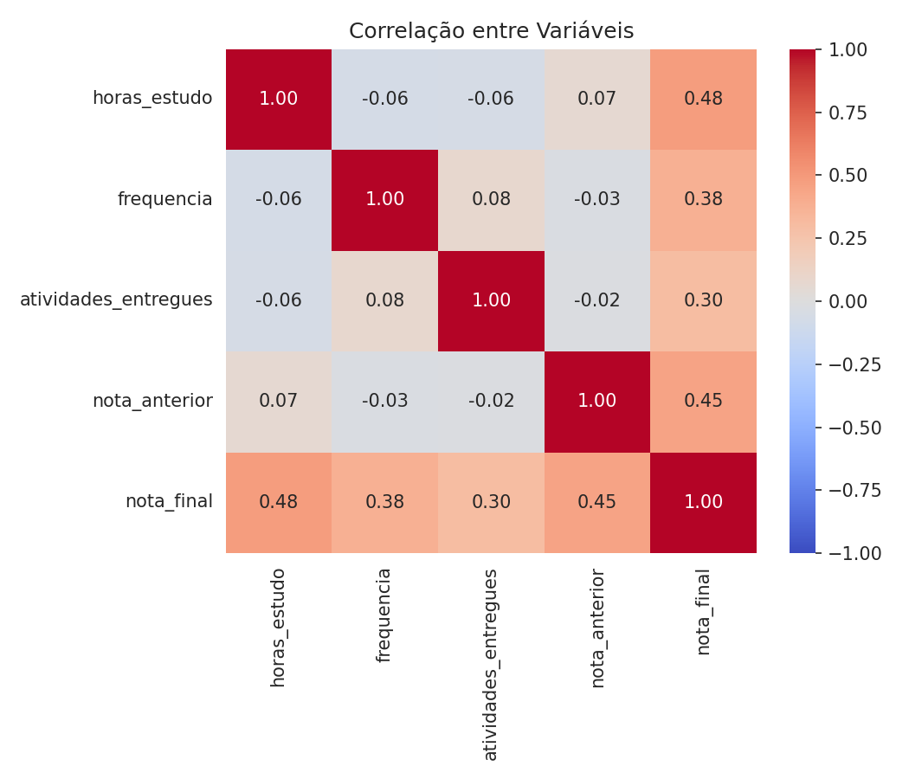
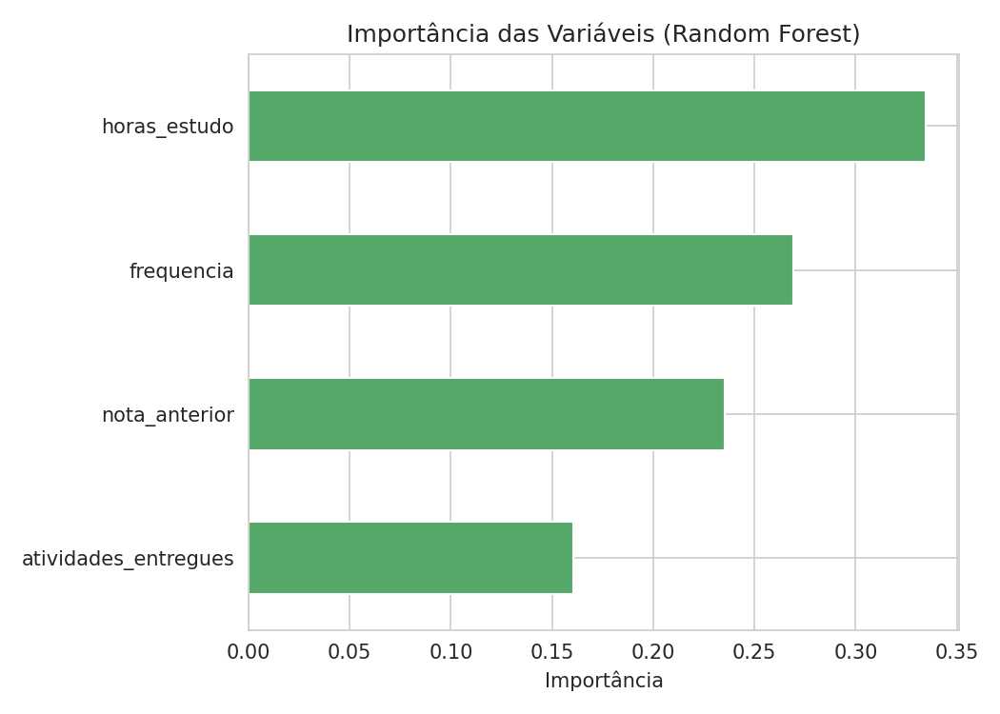

# 🎓 Previsão da Nota Final com Machine Learning

<p align="center">
  Projeto de Machine Learning desenvolvido em Python para estimar o desempenho acadêmico de estudantes com base em indicadores educacionais.
</p>

<p align="center">
  
  
  
  
</p>

---

## 📌 Sobre o projeto

Projeto desenvolvido como atividade prática da disciplina de **Inteligência Artificial e DevOps**.

A aplicação utiliza técnicas de Machine Learning para prever a nota final de estudantes a partir de informações relacionadas ao seu desempenho acadêmico.

Para isso, é gerada uma base de dados sintética com 500 alunos, considerando diferentes variáveis, como horas de estudo, frequência, atividades entregues e nota anterior.

O projeto utiliza dois modelos de aprendizado de máquina, **Regressão Linear e Random Forest**, permitindo comparar seus resultados e analisar o desempenho das previsões.

## 🎯 Objetivos

- Aplicar conceitos de Machine Learning utilizando Python.
- Desenvolver uma base de dados sintética para experimentação.
- Treinar modelos para previsão de desempenho acadêmico.
- Comparar diferentes algoritmos de aprendizado de máquina.
- Avaliar a precisão das previsões por meio de métricas estatísticas.
- Utilizar gráficos para visualizar e interpretar os resultados.

## ⚙️ Funcionalidades

- Geração automática de uma base de dados com 500 alunos.
- Processamento e análise das informações acadêmicas.
- Treinamento de modelos de Machine Learning.
- Comparação entre Regressão Linear e Random Forest.
- Cálculo de métricas de avaliação.
- Geração de gráficos para análise dos resultados.
- Exportação da base de dados e dos resultados obtidos.

## 🧠 Modelos de Machine Learning

**1. Regressão Linear**

Modelo utilizado para identificar relações entre as variáveis de entrada e a nota final dos estudantes, realizando previsões a partir dessas relações.

**2. Random Forest**

Modelo baseado em múltiplas árvores de decisão, utilizado como alternativa para comparação de desempenho nas previsões.

## 📊 Variáveis utilizadas

| Variável | Descrição |
|---|---|
| Horas de estudo | Tempo dedicado aos estudos |
| Frequência | Participação nas aulas |
| Atividades entregues | Quantidade de atividades realizadas |
| Nota anterior | Desempenho acadêmico anterior |
| Nota final | Variável que o modelo busca prever |

## 📈 Resultados e avaliação

O modelo foi avaliado utilizando métricas estatísticas para verificar a diferença entre as notas reais e as notas previstas.

| Métrica | Resultado |
|---|---:|
| Média do erro (viés) | -0,0458 |
| Desvio padrão do erro | 0,5476 |
| MAE | 0,4518 |
| RMSE | 0,5467 |
| R² | 0,6658 |
| Intervalo de erro (95%) | [-1,12; 1,03] |

**Análise dos resultados:**

O modelo apresentou um coeficiente de determinação (R²) de aproximadamente 0,67, indicando que explica cerca de 67% da variação das notas finais na base de dados utilizada.

O erro absoluto médio (MAE) foi de aproximadamente 0,45 ponto, considerando uma escala de notas de 0 a 10.

Esses resultados demonstram a aplicação de técnicas de previsão e avaliação de modelos em um cenário educacional simulado.

## 📉 Visualização dos dados

O projeto também gera gráficos para facilitar a interpretação dos resultados.

### Comparação entre valores reais e previstos



### Distribuição dos erros de previsão



### Matriz de correlação



### Importância das variáveis



## 📂 Estrutura do projeto

```text
atividade-03-previsao-de-nota-final/
│
├── previsao_nota_final.py
├── base_alunos.csv
├── grafico_real_vs_previsto.png
├── grafico_distribuicao_erros.png
├── grafico_correlacao.png
├── grafico_importancia_variaveis.png
├── P3_Previsao_Nota_Final.pdf
├── P3_Previsao_Nota_Final.docx
└── README.md
```

## 🛠️ Tecnologias e ferramentas

- **Python 3:** linguagem utilizada no desenvolvimento.
- **Pandas:** manipulação e organização dos dados.
- **Scikit-learn:** treinamento e avaliação dos modelos de Machine Learning.
- **Matplotlib:** criação dos gráficos e visualizações.
- **OnlineGDB:** ambiente online utilizado para executar o código.

## 🚀 Como executar

O projeto foi desenvolvido para execução no compilador online OnlineGDB.

1. Acesse o [OnlineGDB - Python Compiler](https://www.onlinegdb.com/online_python_compiler).
2. Selecione a linguagem Python 3.
3. Abra o arquivo `previsao_nota_final.py`.
4. Copie o código e cole no editor.
5. Clique em **Run** para executar.

*Observação: a execução depende da disponibilidade das bibliotecas utilizadas no ambiente. Caso necessário, utilize um ambiente Python local com as dependências instaladas.*

## 📄 Relatórios

O projeto também conta com relatórios que documentam o desenvolvimento, o código, os gráficos, as métricas e a análise dos resultados.

- [Relatório em PDF](P3_Previsao_Nota_Final.pdf)
- [Relatório em DOCX](P3_Previsao_Nota_Final.docx)

---

## 👨‍💻 Integrante

**João Pedro Machado**

Estudante de Análise e Desenvolvimento de Sistemas.

- GitHub: [@Joaozin54P](https://github.com/Joaozin54P)
- LinkedIn: [@jo4n](https://www.linkedin.com/in/jo4n/)

---

<p align="center">
  Desenvolvido durante a disciplina de <strong>Inteligência Artificial e DevOps</strong>.
</p>